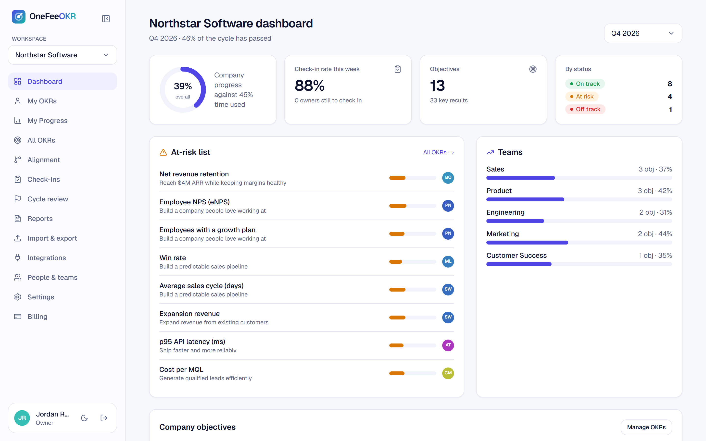
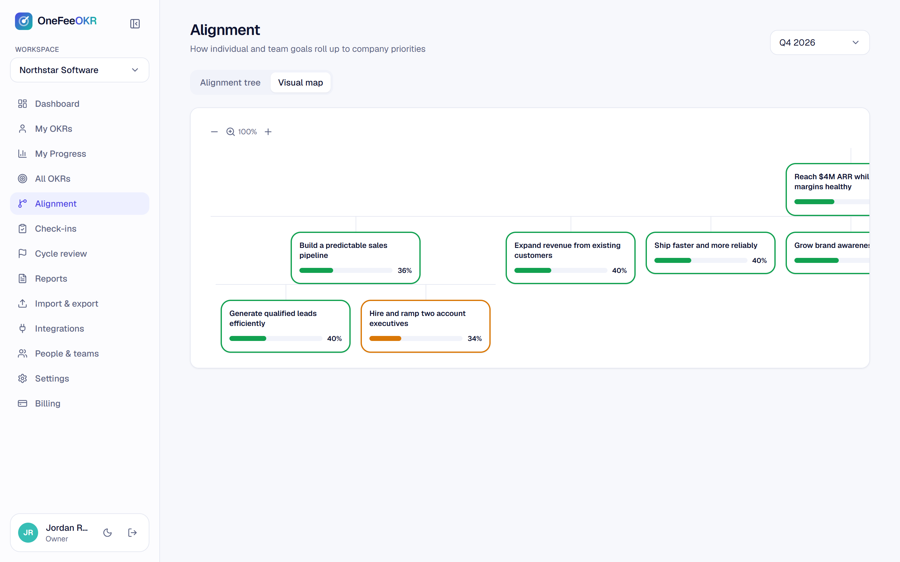
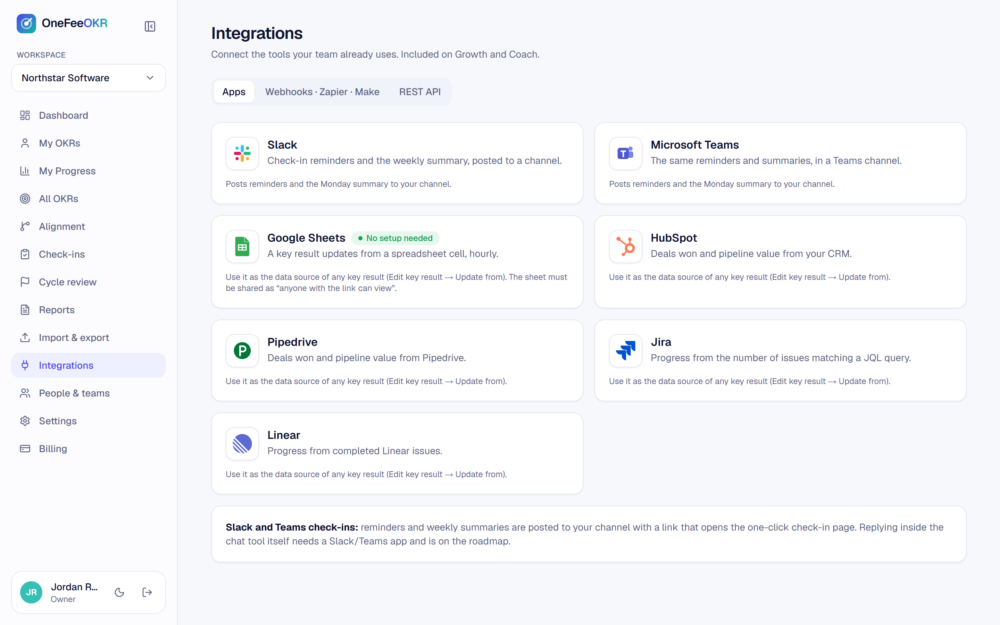
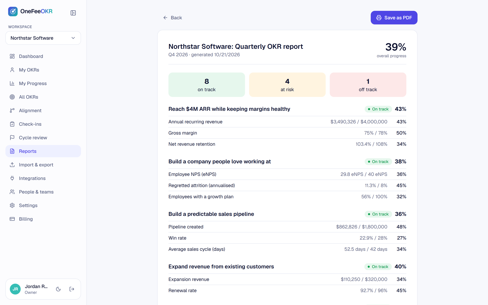
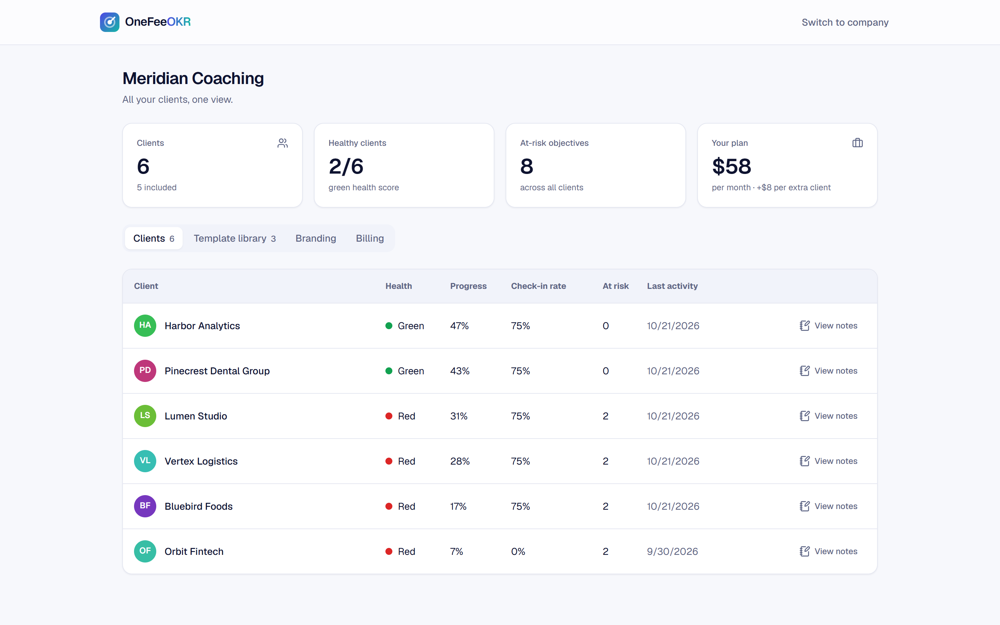

# OneFeeOKR

OKR software with one flat fee per company and unlimited users. I designed, built and launched it solo.

🌐 **Live site:** https://onefeeokr.netlify.app
👁 **Live preview (no signup):** https://onefeeokr.netlify.app/preview
📄 **Case study (with full write-up and more screenshots):** https://portfolio-nextjs-niaziiii.vercel.app/projects/onefeeokr

## The problem

Teams rarely quit OKRs because the method fails. They quit because nobody updates the numbers, and per-seat pricing makes rolling OKRs out to a whole company expensive.

OneFeeOKR charges one flat fee per company with unlimited users and keeps goals alive by bringing the weekly check-in to people's inbox, so nobody has to remember to open another tool.

## Highlights

- **Multi-tenant by design:** 23 Postgres tables isolated by 39 row-level-security policies, 5 workspace roles and a coach mode across client workspaces
- **Billing enforced in the database:** Paddle webhooks drive plan state; expired or unpaid workspaces turn read-only through SQL guard functions, and plan limits are triggers
- **Check-ins that run themselves:** hourly jobs send reminders, nudges and a Monday summary; people update a key result from a one-click email link, no login required
- **A live demo that is the real app:** visitors get a populated workspace in one click — a one-time magic-link token signs them into a seeded account, and restrictive RLS policies keep it read-only
- **Coach console, alignment tree and a zoomable map, cycle reviews, PDF reports, CSV/Excel import and export, dark mode**

## Decisions that shaped it

- Authorization and plan limits live in Postgres (RLS, guard functions, triggers), not only in API code, so the web app, REST API and cron jobs all obey the same rules.
- Typed end to end: a Drizzle schema pulled from the live database, Zod at every boundary and TypeScript on both server and client.
- Background work stays simple and observable: hourly Netlify scheduled functions for check-ins and integration syncs, plus a health endpoint.
- The public demo runs on production infrastructure and is made safe by database-level read-only policies instead of a mocked copy that can drift.

## Stack

Next.js 16 · React 19 · TypeScript · Supabase · PostgreSQL · Drizzle ORM · Zustand · Zod · Tailwind CSS · Paddle · Resend · Netlify

## Screenshots

**Company dashboard** — progress against time, check-in rate, at-risk list and team roll-up

**Zoomable alignment map** — how team goals ladder up to company priorities

**Integrations** — key results that update themselves from Sheets, HubSpot, Pipedrive, Jira and Linear

**Quarterly report** — printable to PDF

**Coach console** — every client's health, progress and check-in rate in one view

---

Source is private; happy to walk through the code in an interview.
